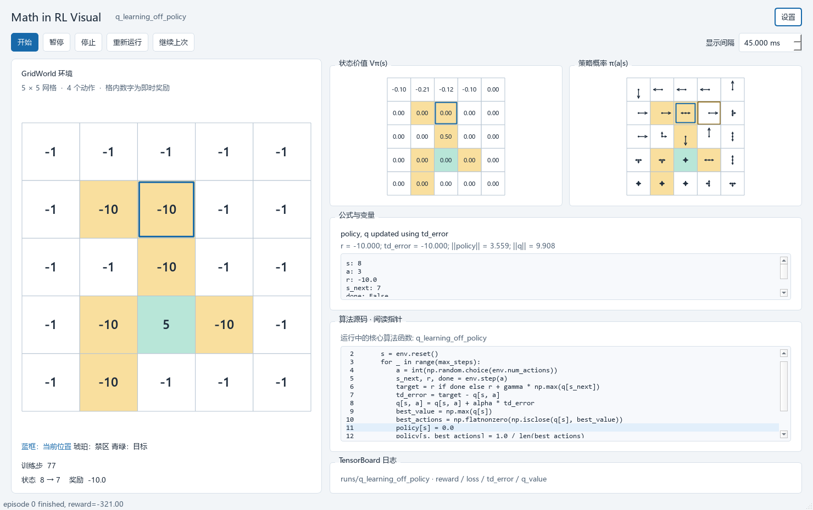
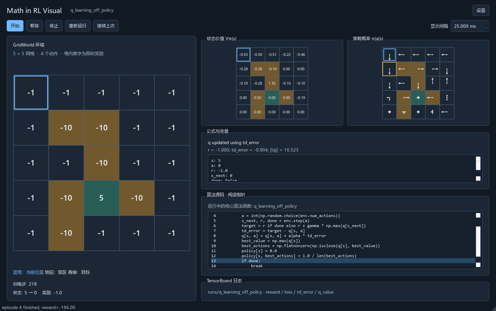
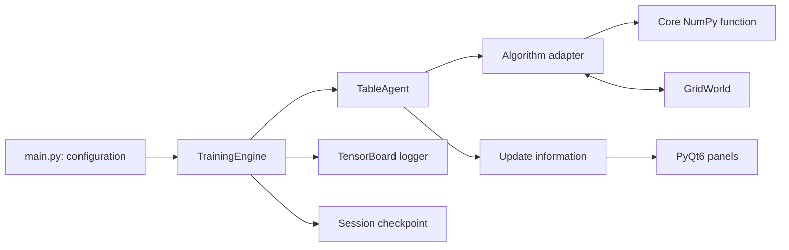

# Math in RL Visual

[English](README.md) | [简体中文](README.zh-CN.md)

[](https://github.com/AstonDky/Math_in_RL_Visual/actions/workflows/checks.yml) [](LICENSE) [](requirements.txt)

A desktop learning tool that connects reinforcement learning algorithms with their equations, source code, policies, and value estimates in GridWorld. It follows the GridWorld examples in Shiyu Zhao's [*Mathematical Foundations of Reinforcement Learning* (《强化学习的数学原理》)](https://github.com/MathFoundationRL/Book-Mathematical-Foundation-of-Reinforcement-Learning).

The project contains 18 compact NumPy algorithm implementations, a hand-written environment, a PyQt6 interface, and TensorBoard logging. It is intended for studying and modifying algorithms, with the core functions kept separate from visualization and session management. Training runs on the CPU; PyTorch, TensorFlow, Gym, and a GPU are not required.



[Watch the 32-second demo](https://github.com/AstonDky/Math_in_RL_Visual/releases/download/v0.1.0/rl-demo.mp4) · [Download v0.1.0](https://github.com/AstonDky/Math_in_RL_Visual/releases/tag/v0.1.0) · [Recording details](docs/media/README.md)

<details>
<summary>Dark theme</summary>



</details>

## Install and run

Use Python 3.12 in a separate environment. The source uses Python 3.10+ syntax; Python 3.12 is the maintained test target. A desktop display is required for normal use. The interface currently uses mainly Chinese labels.

```bash
git clone https://github.com/AstonDky/Math_in_RL_Visual.git
cd Math_in_RL_Visual
python -m venv .venv
```

Activate the environment in your shell:

```powershell
# Windows PowerShell
.\.venv\Scripts\Activate.ps1
```

```bash
# macOS / Linux
source .venv/bin/activate
```

Then install and launch from the repository root:

```bash
python -m pip install -r requirements.txt
python main.py
```

Conda is an alternative: create an environment with `conda create -n MathInRL python=3.12`, activate it with `conda activate MathInRL`, then run the same installation and launch commands. An environment named `MathInRL` is not required.

[requirements.txt](requirements.txt) contains NumPy, PyQt6, TensorBoard, and `setuptools<81`. The setuptools limit preserves `pkg_resources`, which the current TensorBoard launcher checks. Dependencies are version ranges, not a locked environment; record resolved versions when comparing experiments.

## Use the visual trainer

The left grid displays the map, rewards, and agent position. The right side displays update formulas and variables, state values, action probabilities, and the selected core function's source. Drag the dividers to adjust the layout. TensorBoard opens when training starts unless disabled in Settings.

| Control | Action |
| --- | --- |
| 开始 (Start) | Start the prepared session, or resume a paused run. |
| 暂停 (Pause) | Pause training without resetting the agent. |
| 停止 (Stop) | Stop training, save the checkpoint, and stop TensorBoard. |
| 重新运行 (Restart) | Reset the current algorithm's learned state and stored run; leave training idle. |
| 继续上次 (Continue) | Load the current algorithm's checkpoint; press Start to train from it. |
| 间隔 (ms) | Set the visualization delay. Use a positive interval to follow the source display; use zero for faster training. |
| 设置 (Settings) | Choose light/dark theme, text size, display interval, and automatic TensorBoard opening. |

Apply or OK saves display preferences for the next launch; Cancel discards unapplied changes. Window size and panel proportions are also remembered. Restore Defaults changes display preferences only, leaving training checkpoints intact. Algorithm selection and learning parameters remain in `main.py`. Shortcuts: F5 starts/resumes, F6 pauses, F7 stops, and Ctrl+, opens Settings.

The source panel extracts the actual algorithm function and highlights its lines in a staged sequence. It is a reading aid, not an execution debugger. Episode-based algorithms finish a batch before the UI receives it; the grid snapshots for that batch reflect its final tables. The formula panel reports captured update variables, rather than a complete symbolic derivation.

## Select an algorithm

Edit the configuration at the top of [main.py](main.py), then relaunch. There is no command-line algorithm selector or in-window parameter editor.

```python
CORE_ALGORITHM = QAC
ALGORITHM_NAME = CORE_ALGORITHM.__name__
STARTUP_MODE = "restart"  # "restart" or "continue"
```

`QAC` is the repository's default. Set `CORE_ALGORITHM` to any exported function below. All exports are defined in [algorithms/__init__.py](algorithms/__init__.py).

| Family | Function | Implementation |
| --- | --- | --- |
| Dynamic programming | `value_iteration` | [Value iteration](algorithms/value_iteration.py) |
| Dynamic programming | `policy_iteration` | [Policy evaluation and improvement](algorithms/policy_iteration.py) |
| Dynamic programming | `truncated_policy_iteration` | [Truncated policy evaluation](algorithms/truncated_policy_iteration.py) |
| Monte Carlo | `mc_basic` | [Rollouts from each state-action pair](algorithms/mc_basic.py) |
| Monte Carlo | `mc_exploring_starts` | [Exploring-starts control](algorithms/mc_exploring_starts.py) |
| Monte Carlo | `mc_epsilon_greedy` | [Epsilon-greedy control](algorithms/mc_epsilon_greedy.py) |
| TD control | `sarsa_control` | [Tabular Sarsa](algorithms/sarsa_control.py) |
| TD control | `q_learning_on_policy` | [Q-learning with epsilon-greedy behavior](algorithms/q_learning_on_policy.py) |
| TD control | `q_learning_off_policy` | [Q-learning with uniform random behavior](algorithms/q_learning_off_policy.py) |
| Value approximation | `sarsa_fa` | [Sarsa with supplied value/gradient functions](algorithms/sarsa_value_function.py) |
| Value approximation | `q_learning_fa` | [Q-learning with supplied value/gradient functions](algorithms/q_learning_fa.py) |
| Value approximation | `td_value_fa` | [TD state-value prediction](algorithms/td_value_fa.py) |
| Neural value approximation | `deep_q_learning` | [NumPy network, replay, and target network](algorithms/deep_q_learning.py) |
| Policy gradient | `reinforce` | [Monte Carlo policy gradient](algorithms/reinforce.py) |
| Actor-critic | `QAC` | [Action-value critic](algorithms/QAC.py) |
| Actor-critic | `a2c` | [State-value critic and TD advantage](algorithms/a2c.py) |
| Actor-critic | `off_policy_actor_critic` | [Importance-weighted actor update](algorithms/off_policy_actor_critic.py) |
| Actor-critic | `deterministic_actor_critic` | [Discrete argmax teaching variant](algorithms/deterministic_actor_critic.py) |

The two Q-learning names follow the source files. Both use a max-Q bootstrap target; their behavior policies differ. `deterministic_actor_critic` uses discrete action preferences and an argmax update; it is not a continuous-action DDPG implementation. DQN uses a small NumPy network, without a deep-learning framework.

### Training parameters

Edit `ALGORITHM_CONFIG = RLAlgorithmConfig(...)` in `main.py`. The complete parameter definitions are in [core/rl_parameters.py](core/rl_parameters.py), and the signature-based mappings are in [core/algorithm_adapters.py](core/algorithm_adapters.py). Each algorithm uses the parameters present in its function signature; changing a shared field does not make every algorithm use it.

| Parameter | Purpose |
| --- | --- |
| `alpha`, `alpha_theta`, `alpha_w`, `alpha_v` | Learning rates; unset actor/critic-specific rates fall back to `alpha`. |
| `gamma`, `epsilon` | Discount and exploration, where used by the algorithm. |
| `iterations` | Repeated sweeps/updates in algorithms with an iteration parameter. |
| `max_steps` | Shared configuration field; the current episode adapters take their rollout limit from the engine instead. |
| `seed` | NumPy seed, 13 by default. |
| `value_function` | `"table"` or `"linear"` for the supplied action-value helpers. |
| `feature_kind`, `feature_order` | One-hot or Fourier action-value features. |
| `batch_size`, `hidden_units`, `target_update_interval` | DQN minibatch, network width, and target-copy interval in update rounds. |

For linear action-value approximation, select `sarsa_fa` or `q_learning_fa` and set:

```python
value_function="linear",
feature_kind="fourier",
feature_order=2,
```

The `sarsa_fa` adapter automatically enables linear weights. `q_learning_fa` uses a table-shaped weight array when `value_function="table"`. `td_value_fa` currently receives one-hot state-value helpers; the action-value Fourier settings do not change its representation. Actor-critic methods manage their own policy parameters; a `behavior_policy` setting does not override every algorithm's action sampling.

Set `max_steps_per_episode` on the `TrainingEngine` construction in `main.py` to change the rollout limit (200 by default). Current episode adapters use this engine limit rather than `ALGORITHM_CONFIG.max_steps`, and treat reaching the limit as terminal, without a final bootstrap. They run one episode per call; iteration-based algorithms use `iterations` within that call. DQN collects a trajectory and processes a minibatch per update round; its replay list currently has no capacity limit.

## Configure GridWorld

The default map has 5 × 5 states and four actions: up (0), right (1), down (2), and left (3). State IDs are row-major, starting at zero. Cells use `0` for ordinary space, `1` for a forbidden cell, and `2` for a target.

The environment construction in `main.py` sets:

```python
env = GridWorld(
    r_boundary=-10.0,
    r_forbidden=-10.0,
    r_target=5,
    r_other=-1,
    forbidden_blocks=False,
)
```

A boundary action leaves the agent in place. Forbidden cells are traversable with a penalty unless `forbidden_blocks=True`. Entering a target ends the episode. Pass a two-dimensional NumPy `layout` and an optional ordinary-cell `start_state` to `GridWorld` for a different map; see [envs/grid_world.py](envs/grid_world.py). The `GridWorld` constructor's own reward defaults differ from those chosen by `main.py`.

## Checkpoints and TensorBoard

Run from the repository root so paths remain consistent:

```text
sessions/<algorithm>/checkpoint.pkl
runs/<algorithm>/run_<timestamp>/
```

The engine saves at episode boundaries, at its configured save interval, and when stopped. A checkpoint stores learned arrays, algorithm configuration, RNG state, and step/episode counters. Loading starts a new environment episode; it does not resume in the middle of a trajectory. Use the same map dimensions and algorithm when continuing. Only load checkpoints you trust: the format uses Python pickle.

`STARTUP_MODE="restart"` and Restart clear the selected algorithm's old checkpoint and logs. Set `STARTUP_MODE="continue"` before launch to preserve and load an existing checkpoint. Closing the window saves the checkpoint and keeps the logs. Session files are excluded from Git.

TensorBoard binds to `127.0.0.1`, tries ports 6006 through 6025, and uses the same Python interpreter as the app. To inspect saved runs manually:

```bash
python -m tensorboard.main --logdir runs --host 127.0.0.1 --port 6006
```

Metrics include rewards, episode lengths, and algorithm-specific losses or TD errors. Dynamic-programming updates are model sweeps, so their event counts and reported rollout statistics should not be compared directly with sampled trajectories.

## Architecture and extension



| Path | Responsibility |
| --- | --- |
| `algorithms/` | Small algorithm functions, independent of Qt and logging. |
| `core/algorithm_adapters.py` | Supply parameters/helpers and collect algorithm update events. |
| `core/table_agent.py`, `core/rl_parameters.py` | Own tables, weights, policy, configuration, and saved state. |
| `core/engine.py` | Run training in a Qt worker thread and publish updates. |
| `envs/` | Environment interface implementation and transition model. |
| `ui/` | Training controls, map, policy/value views, source display, themes, and persistent preferences. |
| `utils/` | Checkpoints, TensorBoard, and hardware information. |
| `tests/` | Short regression and integration checks. |
| `tools/record_demo.py` | Record the real application with temporary training data and preferences. |

To add an algorithm, keep the numerical function in `algorithms/` and export it explicitly or through a same-name function. Reuse a supported signature, or add its mapping in the adapter. Include a small deterministic example that checks the numerical result and state persistence. See [CONTRIBUTING.md](CONTRIBUTING.md).

## Validation and troubleshooting

```bash
python -m unittest discover -s tests -v
```

The tests use short runs and an offscreen Qt interface. They check state updates, checkpoint behavior, and application integration; they do not establish convergence or benchmark performance. The CI configuration is in [.github/workflows/checks.yml](.github/workflows/checks.yml). Windows with Python 3.12 is the current validation target; macOS and Linux desktop behavior has not been fully validated.

| Problem | Check |
| --- | --- |
| `ModuleNotFoundError` | Install requirements with the same `python` used to run `main.py`. |
| No Qt window / Qt platform plugin error | Run in a desktop session and confirm PyQt6 installed in that environment. `QT_QPA_PLATFORM=offscreen` is for tests, not interactive use. |
| TensorBoard does not open | Read the status bar and the `*_tensorboard_*.log` file under `runs/<algorithm>/`; try the manual command above. |
| A run starts from zero | Check `STARTUP_MODE`; `"restart"` intentionally replaces the selected algorithm's stored run. |
| Training looks frozen | Increase the visualization interval for inspection; large iteration counts can keep an episode batch busy before the next display update. |

## Reference, citation, and license

The book and [author's open course](https://www.shiyuzhao.net/opencourse) provide the mathematical background. This repository is a reader-created implementation. Its inclusion in the book's third-party resources is not a verification of the algorithms by the book author.

Software citation metadata is provided in [CITATION.cff](CITATION.cff). When reporting an experiment, also record the commit, algorithm, configuration, map/rewards, seed, and installed dependency versions.

Project source is licensed under the [MIT License](LICENSE), copyright 2026 Keyan Dong. Dependency and referenced-material licenses apply separately. In particular, [PyQt6 is available under GPLv3 or a Riverbank commercial license](https://www.riverbankcomputing.com/software/pyqt/intro); the project's MIT license does not replace those terms or license the textbook.
