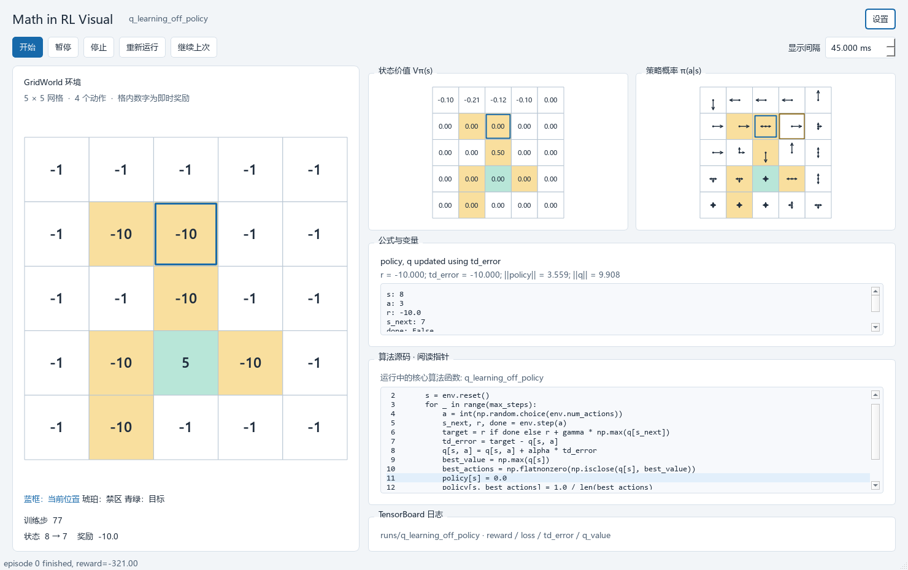
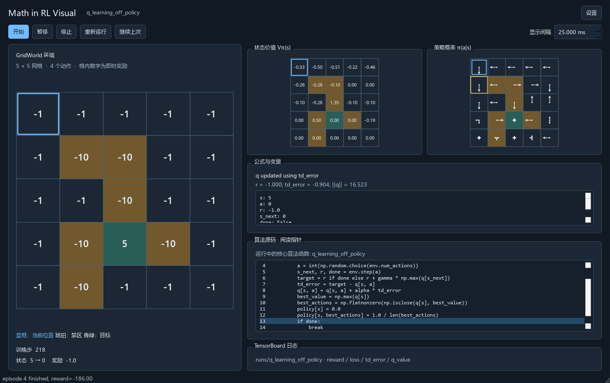
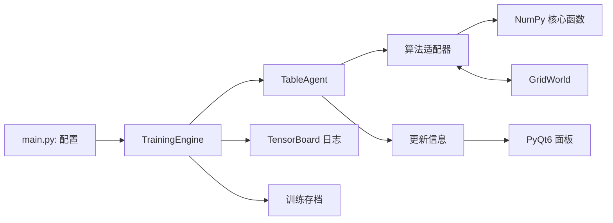

# Math in RL Visual

[English](README.md) | [简体中文](README.zh-CN.md)

[](https://github.com/AstonDky/Math_in_RL_Visual/actions/workflows/checks.yml) [](LICENSE) [](requirements.txt)

一个把强化学习算法、更新公式、源码、策略和价值估计放在同一界面中观察的桌面学习工具。项目沿用赵世钰老师[《强化学习的数学原理》（*Mathematical Foundations of Reinforcement Learning*）](https://github.com/MathFoundationRL/Book-Mathematical-Foundation-of-Reinforcement-Learning)中的 GridWorld 示例，帮助理解公式怎样落实到代码，以及更新如何影响策略与价值。

项目包含 18 个 NumPy 核心算法函数、手写 GridWorld、PyQt6 界面和 TensorBoard 日志。算法代码与界面、训练调度、存档分开，便于阅读和修改。训练使用 CPU，不需要 PyTorch、TensorFlow、Gym 或 GPU。



[观看 32 秒操作演示](https://github.com/AstonDky/Math_in_RL_Visual/releases/download/v0.1.0/rl-demo.mp4) · [下载 v0.1.0](https://github.com/AstonDky/Math_in_RL_Visual/releases/tag/v0.1.0) · [录制说明](docs/media/README.md)

<details>
<summary>深色主题</summary>



</details>

## 安装与运行

建议在独立的 Python 3.12 环境中运行。源码使用 Python 3.10 及以上语法，目前维护的测试版本为 Python 3.12。正常使用需要桌面显示环境，界面目前以中文标签为主。

```bash
git clone https://github.com/AstonDky/Math_in_RL_Visual.git
cd Math_in_RL_Visual
python -m venv .venv
```

按所用终端激活环境：

```powershell
# Windows PowerShell
.\.venv\Scripts\Activate.ps1
```

```bash
# macOS / Linux
source .venv/bin/activate
```

随后在仓库根目录安装依赖并启动：

```bash
python -m pip install -r requirements.txt
python main.py
```

也可以使用 Conda：先运行 `conda create -n MathInRL python=3.12`，再运行 `conda activate MathInRL`，最后执行同样的安装和启动命令。环境名称不必是 `MathInRL`。

[requirements.txt](requirements.txt) 包含 NumPy、PyQt6、TensorBoard 和 `setuptools<81`。setuptools 的上限用于保留当前 TensorBoard 启动器检查的 `pkg_resources`。依赖采用版本范围，并未锁定完整环境；比较实验时应另行记录实际安装版本。

## 使用界面

左侧显示地图、奖励与智能体位置。右侧显示更新公式及变量、状态价值、动作概率和所选算法的核心源码。拖动分隔线可调整区域比例；开始训练时默认打开 TensorBoard，也可在设置中关闭自动打开。

| 控件 | 作用 |
| --- | --- |
| 开始 | 启动已准备好的训练会话，或恢复暂停的训练。 |
| 暂停 | 暂停训练，保留当前学习状态。 |
| 停止 | 停止训练、保存 checkpoint，并关闭 TensorBoard 进程。 |
| 重新运行 | 清空当前算法的学习状态及旧存档、日志，等待再次开始。 |
| 继续上次 | 读取当前算法的 checkpoint，再点击开始继续训练。 |
| 间隔 (ms) | 调整可视化延迟。正值便于跟读源码，零值用于较快训练。 |
| 设置 | 选择浅色或深色主题、字号、显示间隔，以及是否自动打开 TensorBoard。 |

点击“应用”或“确定”后，设置会保存到下次启动；“取消”放弃尚未应用的修改。窗口大小和面板比例也会保留。“恢复默认”只调整界面设置，不清除训练存档。算法选择与学习参数仍在 `main.py` 中修改。快捷键为 F5 开始或恢复、F6 暂停、F7 停止、Ctrl+, 打开设置。

源码区直接提取算法函数，并按顺序分阶段高亮，帮助对照阅读；它不是逐行执行的调试器。按回合执行的算法先完成一批计算，再把事件交给界面，同批事件中的网格快照反映回合末的表格状态。公式区展示捕获到的更新变量，不包含完整的符号推导。

## 切换算法

修改 [main.py](main.py) 顶部配置后重新启动。项目目前没有命令行算法选择器，也不能在窗口内编辑训练参数。

```python
CORE_ALGORITHM = QAC
ALGORITHM_NAME = CORE_ALGORITHM.__name__
STARTUP_MODE = "restart"  # "restart" 或 "continue"
```

仓库默认选择 `QAC`。将 `CORE_ALGORITHM` 改为下列任一导出函数即可切换；导出入口见 [algorithms/__init__.py](algorithms/__init__.py)。

| 类别 | 函数 | 实现入口 |
| --- | --- | --- |
| 动态规划 | `value_iteration` | [价值迭代](algorithms/value_iteration.py) |
| 动态规划 | `policy_iteration` | [策略评估与改进](algorithms/policy_iteration.py) |
| 动态规划 | `truncated_policy_iteration` | [截断策略评估](algorithms/truncated_policy_iteration.py) |
| 蒙特卡洛 | `mc_basic` | [从各状态动作对采样轨迹](algorithms/mc_basic.py) |
| 蒙特卡洛 | `mc_exploring_starts` | [探索起点控制](algorithms/mc_exploring_starts.py) |
| 蒙特卡洛 | `mc_epsilon_greedy` | [Epsilon-greedy 控制](algorithms/mc_epsilon_greedy.py) |
| TD 控制 | `sarsa_control` | [表格 Sarsa](algorithms/sarsa_control.py) |
| TD 控制 | `q_learning_on_policy` | [采用 epsilon-greedy 行为策略的 Q-learning](algorithms/q_learning_on_policy.py) |
| TD 控制 | `q_learning_off_policy` | [采用均匀随机行为策略的 Q-learning](algorithms/q_learning_off_policy.py) |
| 价值函数近似 | `sarsa_fa` | [使用外部价值与梯度函数的 Sarsa](algorithms/sarsa_value_function.py) |
| 价值函数近似 | `q_learning_fa` | [使用外部价值与梯度函数的 Q-learning](algorithms/q_learning_fa.py) |
| 价值函数近似 | `td_value_fa` | [TD 状态价值预测](algorithms/td_value_fa.py) |
| 神经网络价值近似 | `deep_q_learning` | [NumPy 网络、经验回放和目标网络](algorithms/deep_q_learning.py) |
| 策略梯度 | `reinforce` | [蒙特卡洛策略梯度](algorithms/reinforce.py) |
| Actor-critic | `QAC` | [动作价值 critic](algorithms/QAC.py) |
| Actor-critic | `a2c` | [状态价值 critic 与 TD 优势](algorithms/a2c.py) |
| Actor-critic | `off_policy_actor_critic` | [重要性加权的 actor 更新](algorithms/off_policy_actor_critic.py) |
| Actor-critic | `deterministic_actor_critic` | [离散 argmax 教学变体](algorithms/deterministic_actor_critic.py) |

两个 Q-learning 名称沿用源码。两者都使用最大 Q 值构造更新目标，区别在于采样时的行为策略。`deterministic_actor_critic` 使用离散动作偏好与 argmax 更新，不是连续动作 DDPG。DQN 使用小型 NumPy 网络，不依赖深度学习框架。

### 训练参数

在 `main.py` 中修改 `ALGORITHM_CONFIG = RLAlgorithmConfig(...)`。完整参数定义见 [core/rl_parameters.py](core/rl_parameters.py)，按函数签名传参的逻辑见 [core/algorithm_adapters.py](core/algorithm_adapters.py)。算法只使用自身签名接收的参数，并非所有公共字段都会影响每个算法。

| 参数 | 用途 |
| --- | --- |
| `alpha`、`alpha_theta`、`alpha_w`、`alpha_v` | 学习率；未单独设置的 actor/critic 学习率沿用 `alpha`。 |
| `gamma`、`epsilon` | 折扣与探索参数，是否使用由算法决定。 |
| `iterations` | 对具有迭代参数的算法设置扫描或更新次数。 |
| `max_steps` | 共享配置字段；当前回合适配器实际使用引擎传入的轨迹长度上限。 |
| `seed` | NumPy 随机种子，默认为 13。 |
| `value_function` | 动作价值辅助函数使用 `"table"` 或 `"linear"`。 |
| `feature_kind`、`feature_order` | One-hot 或 Fourier 动作价值特征。 |
| `batch_size`、`hidden_units`、`target_update_interval` | DQN 的批量大小、隐层宽度与目标网络复制间隔，间隔按更新轮次计。 |

要使用线性动作价值近似，可选择 `sarsa_fa` 或 `q_learning_fa`，并设置：

```python
value_function="linear",
feature_kind="fourier",
feature_order=2,
```

`sarsa_fa` 适配器会自动启用线性权重。`q_learning_fa` 在 `value_function="table"` 时使用表格形状的权重。`td_value_fa` 目前使用 one-hot 状态价值辅助函数，不会因动作价值 Fourier 配置而改变表示。Actor-critic 算法维护自己的策略参数，`behavior_policy` 也不会覆盖所有算法内部的动作采样。

修改轨迹长度时，在 `main.py` 创建 `TrainingEngine` 的位置设置 `max_steps_per_episode`，默认为 200。当前回合适配器使用该引擎参数，而不是 `ALGORITHM_CONFIG.max_steps`，达到上限时按终止处理，末步不再 bootstrap。适配器每次调用运行一个回合；迭代型算法在调用内使用 `iterations`。DQN 每轮收集一条轨迹并处理一个 minibatch，目前回放列表没有容量上限。

## 配置 GridWorld

默认地图为 5 × 5，动作依次为上（0）、右（1）、下（2）、左（3）。状态按行从零编号。地图编码 `0` 表示普通格，`1` 表示禁止格，`2` 表示目标格。

`main.py` 中的环境配置为：

```python
env = GridWorld(
    r_boundary=-10.0,
    r_forbidden=-10.0,
    r_target=5,
    r_other=-1,
    forbidden_blocks=False,
)
```

越界动作会让智能体停在原地。禁止格默认可以进入，但会得到惩罚；设置 `forbidden_blocks=True` 后会阻挡移动。进入目标格结束回合。更换地图时，向 `GridWorld` 传入二维 NumPy `layout`，可同时指定指向普通格的 `start_state`，详见 [envs/grid_world.py](envs/grid_world.py)。`GridWorld` 构造函数自身的奖励默认值与 `main.py` 的选择不同。

## 存档与 TensorBoard

从仓库根目录启动，保持相对路径一致：

```text
sessions/<algorithm>/checkpoint.pkl
runs/<algorithm>/run_<timestamp>/
```

引擎在回合结束、达到保存间隔和停止时保存 checkpoint，其中包含学习数组、算法配置、随机状态以及步数、回合计数。恢复后从新的环境回合继续，不会回到轨迹中途。继续训练时应使用相同算法与地图尺寸。checkpoint 使用 Python pickle，只应读取可信来源的文件。

`STARTUP_MODE="restart"` 和“重新运行”都会清理当前算法的旧 checkpoint 与日志。需要保留并读取已有存档时，启动前设置 `STARTUP_MODE="continue"`。关闭窗口会保存 checkpoint 并保留日志。运行文件不纳入 Git。

TensorBoard 使用与应用相同的 Python，绑定 `127.0.0.1`，依次尝试 6006 至 6025 端口。也可以手动查看保存的日志：

```bash
python -m tensorboard.main --logdir runs --host 127.0.0.1 --port 6006
```

指标包括奖励、回合长度，以及算法提供的损失或 TD 误差。动态规划使用模型扫描，其事件计数和 rollout 统计不能直接与环境采样轨迹比较。

## 代码结构与扩展



| 路径 | 用途 |
| --- | --- |
| `algorithms/` | 不依赖 Qt 和日志的小型算法函数。 |
| `core/algorithm_adapters.py` | 传入参数和辅助函数，收集算法更新事件。 |
| `core/table_agent.py`、`core/rl_parameters.py` | 管理表格、权重、策略、配置和保存状态。 |
| `core/engine.py` | 在 Qt 工作线程中训练并发布更新。 |
| `envs/` | 环境及状态转移模型。 |
| `ui/` | 训练控制、地图、策略与价值显示、源码展示、主题及持久化设置。 |
| `utils/` | 存档、TensorBoard 和硬件信息。 |
| `tests/` | 短程回归与集成检查。 |
| `tools/record_demo.py` | 使用临时训练数据与设置录制实际应用。 |

新增算法时，将数值函数放在 `algorithms/`，通过显式导出或与模块同名的函数导出。优先复用已有签名，否则在适配器中添加映射，并提供能检查数值与存档状态的小型确定性示例。具体要求见 [CONTRIBUTING.md](CONTRIBUTING.md)。

## 验证与常见问题

```bash
python -m unittest discover -s tests -v
```

测试使用短程运行和不显示窗口的 Qt 环境，检查状态更新、存档行为及应用集成，不代表已经证明算法收敛或完成性能基准。CI 配置见 [.github/workflows/checks.yml](.github/workflows/checks.yml)。目前验证目标是 Windows 与 Python 3.12，尚未全面验证 macOS 和 Linux 的桌面行为。

| 问题 | 检查方式 |
| --- | --- |
| `ModuleNotFoundError` | 确认安装依赖和启动应用使用同一个 `python`。 |
| 没有 Qt 窗口或出现平台插件错误 | 使用桌面会话，确认该环境中安装了 PyQt6。`QT_QPA_PLATFORM=offscreen` 仅用于测试，不适合交互使用。 |
| TensorBoard 没有打开 | 查看状态栏及 `runs/<algorithm>/` 下的 `*_tensorboard_*.log`，也可执行上面的手动启动命令。 |
| 训练从零开始 | 检查 `STARTUP_MODE`；`"restart"` 会按设计替换当前算法的旧训练。 |
| 训练看起来停住 | 调高可视化间隔便于观察；较大的迭代次数可能让一批回合计算持续较久，完成后才更新界面。 |

## 参考资料、引用与许可

数学背景请参考教材和[作者公开课程](https://www.shiyuzhao.net/opencourse)。本仓库是读者实现；教材仓库在第三方资源中列出本项目，不代表教材作者验证过这些算法。

软件引用信息见 [CITATION.cff](CITATION.cff)。报告实验时，还应记录提交版本、算法、参数、地图与奖励、随机种子和依赖版本。

项目源码采用 [MIT License](LICENSE)，版权归 Keyan Dong，2026。依赖与引用材料分别遵循各自许可。特别是 [PyQt6 使用 GPLv3 或 Riverbank 商业许可](https://www.riverbankcomputing.com/software/pyqt/intro)，本项目的 MIT 许可不替代其条款，也不授予教材的使用许可。
